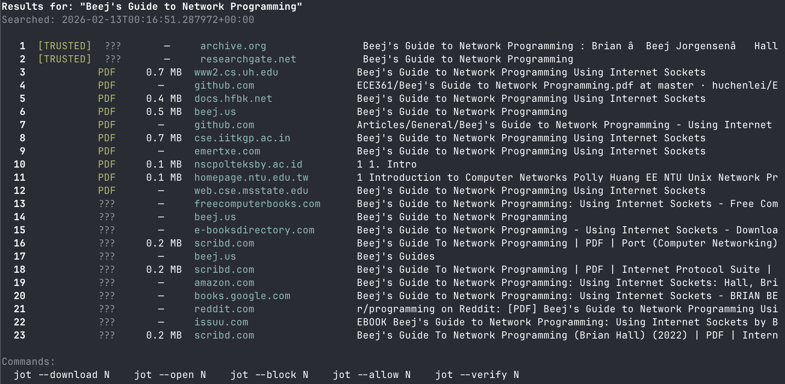

# jot

Source content from anywhere with one command. Pass a YouTube URL and get a clean, timestamped markdown transcript. Pass anything else and search for free PDFs across the web.

## Install

**1. Install [uv](https://docs.astral.sh/uv/)** (runs the script and manages dependencies automatically):
```bash
curl -LsSf https://astral.sh/uv/install.sh | sh
```

**2. Install ffmpeg** (required for YouTube audio extraction when captions aren't available):
```bash
# Mac
brew install ffmpeg

# Ubuntu/Debian
sudo apt install ffmpeg
```

**3. Clone and install as a command:**
```bash
git clone <repo-url> && cd kbxJOT
uv tool install .
```
This installs a real `jot` executable to `~/.local/bin/jot` (make sure that's on your `PATH` — run `uv tool update-shell` once if needed). No shell alias required.

> **Note:** macOS/BSD ship a built-in `jot` utility at `/usr/bin/jot`. The installed command shadows it only if `~/.local/bin` comes *before* `/usr/bin` on your `PATH` (the default with `uv tool update-shell`). Verify with `which jot` — it should print `~/.local/bin/jot`.
>
> Upgrade after pulling changes: `uv tool install --force .`  ·  Uninstall: `uv tool uninstall jot`

**4. Configure your keys:**
```bash
mkdir -p ~/.config/jot
cp .env.example ~/.config/jot/.env
```
Then edit `~/.config/jot/.env` and add your keys:

| Key | Required? | What for | Get one at |
|---|---|---|---|
| `BRAVE_API_KEY` | For PDF search | Web search for free PDFs | [brave.com/search/api](https://brave.com/search/api/) |
| `ANTHROPIC_API_KEY` | Recommended | Transcript paragraph formatting & filler word removal | [console.anthropic.com](https://console.anthropic.com/) |
| `ASSEMBLYAI_API_KEY` | For diarization / fallback | Transcription when no YouTube captions exist | [assemblyai.com](https://www.assemblyai.com/dashboard/signup) |

jot looks for `.env` in this order (first match wins):
`$JOT_ENV_FILE` → `~/.config/jot/.env` → `./.env` (current directory) → next to the source.

### Where jot stores its state

All runtime state lives in `~/.config/jot/` (override with `JOT_CONFIG_DIR`; also respects `XDG_CONFIG_HOME`):

| File | Purpose |
|---|---|
| `.env` | Your API keys |
| `domains.md` | Allow/block lists for PDF search |
| `config.json` | Persistent PDF download directory |
| `.last_results.json` | Cache of the last search (for `--download N`, etc.) |

### Running without installing (development)

The script keeps its inline [PEP 723](https://peps.python.org/pep-0723/) dependency metadata, so you can run it directly during development without installing:
```bash
uv run jot.py 'https://www.youtube.com/watch?v=VIDEO_ID'
```

## Quick start

```bash
# Search for a PDF
jot "Designing Data-Intensive Applications"

# Transcribe a YouTube video
jot 'https://www.youtube.com/watch?v=VIDEO_ID'
```

jot detects YouTube URLs automatically. Everything else is treated as a PDF search query.

## PDF search

```bash
jot "Book Title"                      # Search for a PDF
jot "DDIA" --author "Martin Kleppmann" # Search with author filter
jot --download 3                       # Download result #3 to ~/Books/
jot --open 3                           # Download and open in your PDF viewer
jot --verify 3                         # Check PDF content without downloading
jot --block 4                          # Block the domain of result #4
jot --allow 2                          # Trust the domain of result #2
jot --results                          # Re-display last search results
jot --domains                          # Show allow/block lists
jot "query" -o ~/PDFs                  # Custom download directory
jot --path                             # Show current download directory
jot --path ~/PDFs                      # Set persistent download directory
```



### How PDF search works

1. Runs multiple query variations against Brave Search
2. HEAD-checks each URL to confirm PDF content-type and file size
3. Ranks results: trusted domains first, confirmed PDFs next, blocked domains last
4. On download, verifies the PDF content matches your query before saving
5. Downloads with a progress bar to `~/Books/` (configurable via `--path`)

### Domain lists

jot ships with pre-configured allow/block lists in `domains.md`. Trusted sources (archive.org, gutenberg.org, arxiv.org, etc.) are ranked higher. Known piracy and spam domains are filtered out. You can edit `domains.md` directly or use `--block N` / `--allow N`.

## YouTube transcription

```bash
jot 'https://www.youtube.com/watch?v=VIDEO_ID'                # Basic transcription
jot 'https://www.youtube.com/watch?v=VIDEO_ID' --diarize      # Speaker diarization
jot 'https://www.youtube.com/watch?v=VIDEO_ID' -o ~/notes     # Custom output directory
jot 'https://www.youtube.com/watch?v=VIDEO_ID' --skip-captions # Skip captions, use AssemblyAI
```

| Flag | Description |
|---|---|
| `--diarize` | Force speaker diarization via AssemblyAI |
| `--output DIR` / `-o DIR` | Output directory (default: `./transcripts`) |
| `--skip-captions` | Skip YouTube captions, use AssemblyAI directly |

### How transcription works

```
YouTube URL
    |
    +---> [1] Fetch YouTube captions (free, instant)
    |         +---> Found? ---> Claude cleans up + adds paragraph breaks ---> .md
    |
    +---> [2] No captions OR --diarize / --skip-captions
              +---> Download audio (yt-dlp + ffmpeg)
              +---> AssemblyAI transcription (+ speaker labels if diarized)
                        +---> .md
```

- **YouTube captions** cover ~90% of videos for free
- **Claude Sonnet** handles paragraph formatting and filler word removal
- **AssemblyAI** is the fallback for videos without captions, or when you want speaker diarization

### Transcript output

Files save to `./transcripts/` by default, named after the video title.

```markdown
# How Transformers Work

| | |
|---|---|
| **Channel** | 3Blue1Brown |
| **Source** | <https://youtube.com/watch?v=...> |
| **Uploaded** | 2025-01-15 |
| **Duration** | 22:15 |
| **Transcribed** | 2025-01-20 14:30 UTC |
| **Method** | YouTube captions (auto-generated) |

---

## Transcript

[00:00] So today we're going to talk about transformers and why
attention mechanisms are really the key insight here...

[01:45] The fundamental idea is actually quite simple. Instead of
processing a sequence one element at a time...
```

With `--diarize`, speaker labels are added:

```markdown
[00:00] **Speaker A:** Welcome back to the show. Today I'm joined by...

[00:05] **Speaker B:** Thanks for having me. I've been thinking a lot about...
```

### Annotating transcripts

After reading a transcript, you can mark high-value sections with HTML comment tags. These are invisible in rendered markdown but visible to LLMs, so when you feed the transcript into a future session the model knows what you valued most.

```markdown
<!-- value: high -->
[45:30] The key insight is that software engineering has always been about
balancing forces — technical, economic, and ethical...
<!-- /value -->
```

## Cost

| Feature | Cost | When |
|---|---|---|
| PDF search | Free | Uses Brave Search free tier (2,000 queries/month) |
| YouTube captions | Free | Captions exist on the video |
| Claude formatting | ~$0.01-0.05 | Per transcript (paragraph breaks + cleanup) |
| AssemblyAI | ~$0.37/hr | No captions, or `--diarize` flag |

## Troubleshooting

| Problem | Fix |
|---|---|
| `BRAVE_API_KEY not set` | Add your key to `.env` |
| "No English captions available" then API error | Set `ASSEMBLYAI_API_KEY` in `.env` |
| "ffmpeg not found" | Install ffmpeg: `brew install ffmpeg` |
| Audio download fails | Update yt-dlp: `uv tool install yt-dlp` |
| Single giant paragraph (no breaks) | Set `ANTHROPIC_API_KEY` in `.env` |
